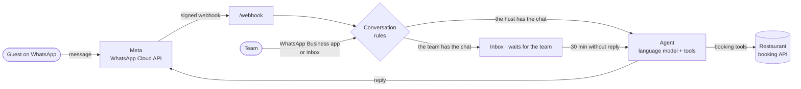

<div align="center">

# GIRA WhatsApp Agent

### The restaurant's host, on WhatsApp.

Guests write to the restaurant on WhatsApp — in French, Italian, German, Spanish, English, Tunisian
or Moroccan Arabic — and get an answer at once: the menu, the opening hours, the way there, and a
table booked, found or cancelled. When someone from the team steps in, the host steps back.

[](https://github.com/siwar224/gira-whatsapp-agent/actions/workflows/ci.yml)


[](LICENSE)

</div>

---

## What it does

**For guests**

- **Answers right away**, in the guest's own language and style — including Tunisian Derja and
  Moroccan Darija written in Latin letters ("3aslema, famma blassa ghodwa?").
- **Knows the restaurant**: menu and prices, vegetarian and vegan dishes, opening hours, address,
  areas (window, main room, chef's counter, terrace) and house rules.
- **Books a table** on the restaurant's real booking system: checks which times are free, picks the
  best table for the party, confirms with the guest, and returns the booking code.
- **Finds or cancels a booking** — only from the phone number it was made with — and adds guests to
  the waiting list when an evening is full.
- **Hands over to a person** when a guest asks for one, has a complaint, or needs something the host
  can't do.

**For the team**

- **The team can take any chat.** As soon as someone replies — from the WhatsApp Business app on
  the same number, or from the inbox — the chat is theirs and the host stays out of it.
- **No guest is left waiting.** In a chat the team has taken, a guest message left unanswered for
  30 minutes is answered by the host. Both delays are set from the dashboard.
- **An inbox of its own**: every conversation, its status (*Agent*, *Team*, *Guest waiting*,
  *Needs a person*), team replies, take over / hand back, and a playground to try the host without
  WhatsApp.
- **Private by design**: conversations are deleted 48 hours after their last message, logs never
  contain message text or full phone numbers, and webhook calls are verified with Meta's signature.

## How it works



| Part | Where |
|---|---|
| Webhook, verification, signature check | [`app/api/webhook.py`](app/api/webhook.py), [`app/whatsapp/`](app/whatsapp) |
| Conversation rules (instant reply, takeover, safety net, retention) | [`app/services/conversations.py`](app/services/conversations.py) |
| Agent loop and instructions | [`app/agent/runner.py`](app/agent/runner.py), [`app/agent/prompt.py`](app/agent/prompt.py) |
| Booking tools | [`app/agent/tools.py`](app/agent/tools.py), [`app/booking/client.py`](app/booking/client.py) |
| The restaurant itself — menu, hours, tables, rules | [`config/business.yaml`](config/business.yaml) |
| Countries, languages, phone numbers | [`app/business/`](app/business) |
| Admin interface | [`app/admin/`](app/admin) |
| Database and migrations | [`app/db/`](app/db), [`migrations/`](migrations) |

## Countries

The restaurant can be in any of these countries; guests can write from anywhere.

| Country | Code | Time zone | Languages expected |
|---|---|---|---|
| 🇹🇳 Tunisia | `TN` | Africa/Tunis | Tunisian Derja, French, Arabic |
| 🇲🇦 Morocco | `MA` | Africa/Casablanca | Moroccan Darija, French, Arabic, Amazigh |
| 🇫🇷 France | `FR` | Europe/Paris | French |
| 🇮🇹 Italy | `IT` | Europe/Rome | Italian |
| 🇩🇪 Germany | `DE` | Europe/Berlin | German |
| 🇪🇸 Spain | `ES` | Europe/Madrid | Spanish, Catalan, Basque, Galician |

Set `country` in [`config/business.yaml`](config/business.yaml). Phone numbers typed in the local
format ("20 123 456" in Tunisia, "06 12 34 56 78" in France…) are understood, and stored in
international format.

## Run it locally

Requirements: Python 3.11+.

```bash
python -m venv .venv
```

```bash
.venv/bin/pip install -e ".[dev]"        # Windows: .venv\Scripts\pip install -e ".[dev]"
```

```bash
cp .env.example .env                     # set ADMIN_PASSWORD and SESSION_SECRET at least
```

```bash
.venv/bin/uvicorn app.main:create_app --factory --reload
```

Open <http://localhost:8000/admin> and sign in. Without WhatsApp keys the inbox and dashboard work,
and with an `ANTHROPIC_API_KEY` the **Playground** lets you talk to the host. API docs are at
<http://localhost:8000/docs>.

With Docker and PostgreSQL:

```bash
docker compose up --build
```

## Configuration

Everything is configured through environment variables — see [`.env.example`](.env.example).

| Variable | Purpose |
|---|---|
| `WHATSAPP_ACCESS_TOKEN`, `WHATSAPP_PHONE_NUMBER_ID`, `WHATSAPP_APP_SECRET`, `WHATSAPP_VERIFY_TOKEN` | WhatsApp Cloud API — [setup guide](docs/whatsapp-setup.md) |
| `ANTHROPIC_API_KEY`, `ANTHROPIC_MODEL`, `ANTHROPIC_EFFORT` | The language model behind the host |
| `BOOKING_API_URL` | The restaurant website whose booking API the host uses |
| `DATABASE_URL` | SQLite locally, PostgreSQL in production |
| `ADMIN_USERNAME`, `ADMIN_PASSWORD`, `SESSION_SECRET` | Sign-in to the admin interface |
| `RUN_SCHEDULER`, `INTERNAL_TOKEN` | Run the safety net in-process, or from an external cron via `POST /internal/sweep` |
| `RETENTION_HOURS` | How long conversations are kept (default 48) |

The menu, hours, tables and house rules live in [`config/business.yaml`](config/business.yaml): edit
it and restart — no code change needed.

## API

| Endpoint | |
|---|---|
| `GET /webhook` | Meta's verification handshake |
| `POST /webhook` | Incoming WhatsApp events (signed) |
| `GET /health` | Status of the service, database, WhatsApp and model configuration |
| `POST /internal/sweep` | Run the 30-minute safety net now (header `X-Internal-Token`) |
| `/admin` | Dashboard, inbox, conversations, settings, playground |

## Quality

```bash
pytest
```

```bash
ruff check . && ruff format --check .
```

The test suite covers the webhook (handshake, signatures, redelivery, out-of-order events), every
conversation rule (instant reply, takeover, the 30-minute safety net, hand back, retention), the
booking tools against a mocked booking API, phone numbers for all six countries, the agent loop, the
WhatsApp client and the admin interface. CI runs it on every push, applies the migrations to a real
PostgreSQL and builds the Docker image.

## Deploying

The image runs migrations and then serves on `$PORT`:

```bash
docker build -t gira-whatsapp-agent .
```

```bash
docker run --env-file .env -p 8000:8000 gira-whatsapp-agent
```

Run **one** instance (the safety net runs inside the process), behind HTTPS, with
`APP_ENV=production` and `SESSION_HTTPS_ONLY=true`. In production the service refuses to start until
every required secret is set. Then point Meta's webhook at `https://<your-domain>/webhook`
([guide](docs/whatsapp-setup.md)).

## License

[MIT](LICENSE) © 2026 siwar224
